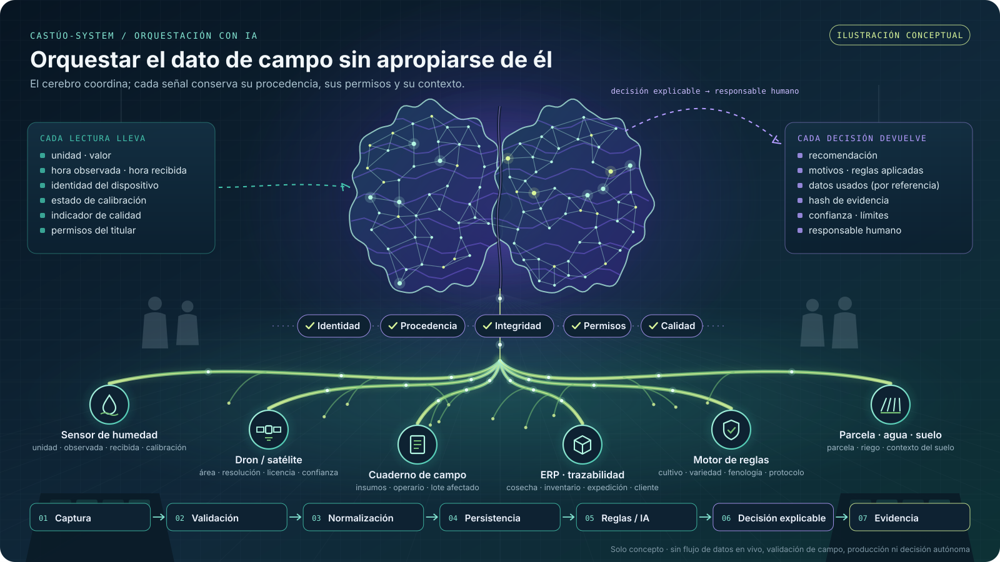

# Gregorio Julián Jiménez Bodes · Traky12

  

<!-- CASTUO:BRAND:START -->

  

<!-- CASTUO:BRAND:END -->

  <strong>Arquitecto de sistemas · Ingeniero de evidencia · Gobernanza y aseguramiento de IA</strong> 
  Fundador y arquitecto principal de CASTÚO-SYSTEM™

  Diseño infraestructura basada en evidencia para operaciones trazables, resilientes sin conexión y revisables de forma independiente.

  
  
  

> **Ningún claim sin procedencia. Ningún claim externo sin evidencia reproducible.**

---

## Herramienta destacada · e3bundle

**[e3bundle](https://github.com/Traky12/castuo-e3-001)** es una herramienta CLI de Python con licencia MIT para crear, firmar y verificar paquetes de evidencia portables sin conexión. Genera manifiestos SHA-256 y verifica firmas Ed25519 conforme a reglas de confianza configuradas explícitamente.

  

**Qué permite**
- Detectar archivos modificados, ausentes o añadidos respecto al manifiesto.
- Comprobar firmas usando las claves públicas y la política de confianza proporcionadas por el operador.
- Producir un resultado de verificación delimitado, utilizable en scripts y revisiones.

### Gate de publicación y revisión del código

La prerelease alfa `v0.1.3` existe en GitHub. Hay una discrepancia documental: el README incluido en ese tag conserva un estado anterior de la release, mientras que el README actual del repositorio documenta el tag para **pruebas alfa delimitadas**. Hasta reconciliar la documentación del tag, este perfil enlaza al código y a la evidencia de publicación, pero no repite un comando de instalación listo para copiar. No es una recomendación para producción.

- [Instrucciones actuales de release y prueba alfa](https://github.com/Traky12/castuo-e3-001/blob/main/README.md#install)
- [Inspeccionar el código fijado de `v0.1.3`](https://github.com/Traky12/castuo-e3-001/tree/v0.1.3) · [Consultar las notas de la prerelease](https://github.com/Traky12/castuo-e3-001/releases/tag/v0.1.3)
- [Consultar el run fallido de PyPI](https://github.com/Traky12/castuo-e3-001/actions/runs/38088766020) · [Consultar el run satisfactorio de GHCR](https://github.com/Traky12/castuo-e3-001/actions/runs/38088766046)
- [Revisar el gate de publicación y sus bloqueos](docs/PROFILE-STATUS-DETAIL.es.md)
- [Probar la demo de navegador](https://traky12.github.io/castuo-e3-001/) — solo ejemplos sintéticos `v0.1.1`; no valida la release CLI `v0.1.3`.

Los ejemplos sintéticos ilustran el comportamiento definido; no validan de forma independiente CASTÚO-SYSTEM ni demuestran la veracidad de los datos subyacentes.

## Flujo gobernado · de señales agrarias a soberanía de evidencia

  

**El principio:** la capacidad en bruto no es autoridad. Las entradas sintéticas atraviesan tres umbrales explícitos de *grounding* (0,18 → 0,36 → 0,52); los elementos que cumplen pasan a una cola simulada y después se convierten en eventos sintéticos trazables. El cerebro final es una metáfora visual de **soberanía de evidencia**: la evidencia llega a quien tiene la responsabilidad de decidir, no a una acción automatizada.

> **SIMULATION · SYNTHETIC SOURCES · EXPERIMENTAL · NO PRODUCTION CLAIM**

Es una ilustración vectorial estática y una explicación del modelo; no es una señal de sensores en directo, una demo pública ejecutable, un flujo real de aprobación humana ni un sistema de producción. La cola usa una regla temporal simulada cada 14 pasos; no se modelan actor, aprobación o rechazo humanos. La semilla reproduce una ejecución; no otorga autoridad de gobernanza. No se afirman proveedores reales conectados, datos catastrales reales, validación de campo, decisiones autónomas ni preparación operativa.

- [Leer el alcance, la regla de reproducibilidad y los límites del flujo gobernado](docs/GOVERNED-FLOW-SOVEREIGNTY.md)
- [Consultar el estado público y las compuertas de evidencia abiertas](docs/PROFILE-STATUS-DETAIL.es.md)

## Orquestación con IA · coordinar el dato de campo sin apropiarse de él

  

**El principio:** el cerebro coordina; no se apropia del dato ni da órdenes. El dato de campo conserva su procedencia, sus permisos y su contexto. El orquestador solo trabaja con dato que ha superado los controles de **identidad, procedencia, integridad, permisos y calidad**, y devuelve recomendaciones explicables a un responsable humano.

`Captura → Validación → Normalización → Persistencia → Reglas / IA → Decisión explicable → Evidencia`

> **CONCEPT ILLUSTRATION · TARGET ARCHITECTURE · NO PRODUCTION CLAIM**

Es una ilustración vectorial estática de una arquitectura objetivo. No es un flujo de datos en vivo, un orquestador desplegado, un sistema validado en campo ni un motor de decisión autónoma, y las compuertas de evidencia relacionadas siguen abiertas.

- [Leer la nota de alcance y las preguntas que debe responder cada dato](docs/AI-ORCHESTRATION-BRAIN.md)

## Estado público actual

| Área | Estado actual |
|---|---|
| Release de GitHub | Existe la [prerelease alfa `v0.1.3`](https://github.com/Traky12/castuo-e3-001/releases/tag/v0.1.3); sigue abierta la discrepancia documental del tag |
| PyPI | **Bloqueado** — el run de publicación falló con `invalid-publisher`; el [run original](https://github.com/Traky12/castuo-e3-001/actions/runs/38088766020) y el [gate de Pages en vivo](https://github.com/Traky12/castuo-e3-001/actions/runs/38137298070/job/114463677768) muestran HTTP 404 para `e3bundle 0.1.3` en PyPI. La explicación de los claims OIDC sigue siendo hipótesis, no causa raíz confirmada ([runbook](https://github.com/Traky12/castuo-e3-001/blob/main/docs/PYPI-RELEASE-RUNBOOK.es.md)) |
| Imagen GHCR | La publicación multi-arquitectura pasó y el manifiesto vivo `0.1.3` se verificó en el [gate posterior a la fusión](https://github.com/Traky12/castuo-e3-001/actions/runs/38137298070/job/114463677768) |
| Aviso de seguridad público (`GHSA-55pc-7v4h-jf7c`) | **Bloqueado** — la consulta anónima al registro público devolvió HTTP 404; el registro no confirma actualmente `0.1.3` como versión corregida ([gate](https://github.com/Traky12/castuo-e3-001/actions/runs/38137298070/job/114463677768)) |
| Demo del navegador | La [demo pública](https://traky12.github.io/castuo-e3-001/) sigue usando bundles sintéticos `v0.1.1`; el despliegue de Pages para `v0.1.3` permanece bloqueado por PyPI y el aviso público |
| Visual del flujo gobernado | Concepto vectorial estático y nota de alcance; no es una simulación ejecutable o en directo y no afirma producción |
| Visual de orquestación con IA | Concepto vectorial estático y nota de alcance; no es un orquestador desplegado, un flujo de datos en vivo ni un motor de decisión autónoma |
| Reproducción independiente (E3-001) | `PENDIENTE` — 0 de 2 revisiones externas firmadas; el [issue #30 de testers/reproducción está pausado](https://github.com/Traky12/castuo-e3-001/issues/30) hasta cerrar PyPI, el aviso y Pages |
| Consolidación de CASTÚO-SYSTEM | **BLOCKED** — siguen abiertos los gates de ingeniería, seguridad y evidencia operativa; consulta el [estado detallado](docs/PROFILE-STATUS-DETAIL.es.md) |

**`CONSOLIDATION-1.0 = BLOCKED`.** `Traky12` es el read-model público: informa del estado, pero no decide el estado técnico ni la promoción. `Castuo-system` es la autoridad privada canónica del estado técnico y de las decisiones de promoción; `castuo-evolution` es un espacio no canónico. Consulta el [estado público y el historial](docs/PROFILE-STATUS-DETAIL.es.md) para ver los bloqueos de publicación, las limitaciones y los enlaces de procedencia. Los estados se mantienen separados deliberadamente: una prerelease de GitHub no equivale a publicación en PyPI, demo pública actualizada, reproducción externa ni aprobación para producción.

## Trabajo seleccionado

<table>
  <tr>
    <td width="33%" valign="top">
      <strong><a href="https://github.com/Traky12/castuo-evidence">castuo-evidence</a></strong> 
      Unidades de evidencia pública seleccionadas, manifiestos y artefactos de reproducibilidad.  
      Enfoque: procedencia · revisabilidad
    </td>
    <td width="33%" valign="top">
      <strong><a href="https://github.com/Traky12/castuo-agro-edge">castuo-agro-edge</a></strong> 
      Experimentos de runtime edge e IoT offline-first; no se promocionan claims de campo ni de producción.  
      Enfoque: continuidad · sistemas edge
    </td>
    <td width="33%" valign="top">
      <strong><a href="https://github.com/Traky12/Cast-o">Cast-o</a></strong> 
      Herramientas de prueba y aseguramiento. La suite es parcialmente ejecutable; el benchmarking aún no está demostrado y la licencia sigue bajo revisión de propiedad intelectual.  
      Enfoque: pruebas · assurance
    </td>
  </tr>
</table>

[Mapa completo de repositorios](docs/CASTUO_ECOSYSTEM_PUBLIC_REPOSITORY_MAP.md) · [Límites de claims públicos](PUBLIC_CLAIM_BOUNDARY.es.md) · [Índice de evidencia](evidence-center/README.md)

## Sistemas agro-edge · ámbito de aplicación

  

Solo ilustración conceptual. No representa un sistema desplegado, señales de sensores en vivo, una prueba de campo, resultados agronómicos medidos ni validación de producción.

Esta es la línea visual del ámbito agrícola edge explorado en [castuo-agro-edge](https://github.com/Traky12/castuo-agro-edge). Representa una arquitectura posible —señales de campo, procesamiento local y decisiones trazables—, no un claim operativo ni de validación en campo.

## Principios de ingeniería

- **Trazabilidad antes que afirmaciones.** Vincular los claims con fuentes inspeccionables y comprobaciones reproducibles.
- **Fail-closed.** La falta de confianza, un estado ambiguo o la ausencia de evidencia no deben convertirse silenciosamente en éxito.
- **Capacidad no equivale a madurez.** `DOCUMENTED ≠ IMPLEMENTED ≠ TESTED ≠ VALIDATED ≠ OPERATIONAL`.

## No se declara

Un manifiesto válido permite comprobar si los archivos coinciden con los hashes registrados. Una firma válida demuestra que esa firma verifica con una clave pública y una política configuradas. Ninguna de las dos cosas demuestra que el contenido sea verdadero ni establece de forma independiente la identidad real del firmante.

No se declaran como alcanzadas la reproducción independiente, la validación de campo o producción, la certificación, la conformidad regulatoria, los clientes de pago, los ingresos recurrentes ni la autonomía de IA en producción.

## Contribuir

Empieza con un cambio acotado y reproducible:
- [Issues adecuados para empezar](https://github.com/Traky12/castuo-e3-001/labels/good%20first%20issue)
- [Guía de contribución](https://github.com/Traky12/castuo-e3-001/blob/main/CONTRIBUTING.md)
- [Política de seguridad](https://github.com/Traky12/castuo-e3-001/blob/main/SECURITY.md)

## Enlaces

  <a href="https://castuo-system.es/">CASTÚO-SYSTEM</a> ·
  <a href="https://orcid.org/0009-0007-3489-0565">ORCID</a> ·
  <a href="README.md">English version</a>

  `Traky12` es la vista pública de estado. La autoridad técnica canónica y las decisiones de promoción permanecen en el repositorio privado `Castuo-system`.

