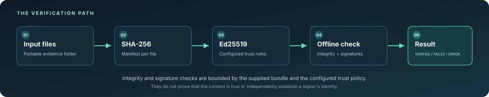
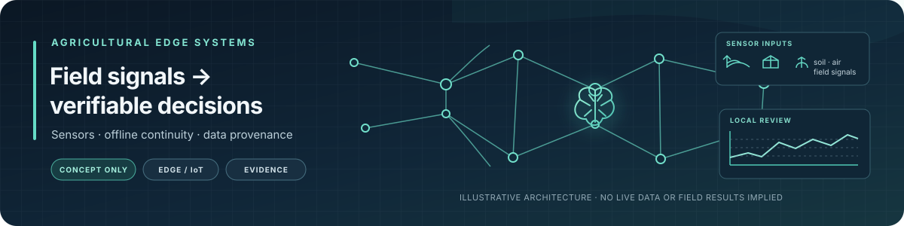

# Gregorio Julián Jiménez Bodes · Traky12

  

<!-- CASTUO:BRAND:START -->

  

<!-- CASTUO:BRAND:END -->

  <strong>Systems Architect · Evidence Engineer · AI Governance &amp; Assurance</strong> 
  Founder and lead architect of CASTÚO-SYSTEM™

  I build evidence-driven infrastructure for operations that must be traceable, resilient offline and independently reviewable.

  
  
  

> **No claim without provenance. No external claim without reproducible evidence.**

---

## Featured tool · e3bundle

**[e3bundle](https://github.com/Traky12/castuo-e3-001)** is a small MIT-licensed Python CLI for creating, signing and verifying portable evidence bundles offline. It creates SHA-256 manifests and verifies Ed25519 signatures against explicitly configured trust rules.

  

**What it does**
- Detects changed, missing or added files against a manifest.
- Checks signatures against the public keys and trust policy supplied by the operator.
- Produces a bounded verification result suitable for scripting and review.

### Release gate and source review

The GitHub `v0.1.3` alpha prerelease exists. There is a documentation conflict: the README stored in that tag still carries an older release-state statement, while the current repository README documents the tag for **bounded alpha testing only**. Until the tag documentation is reconciled, this profile links to the source and release evidence but does not repeat a copy/paste installation command. This is not a production recommendation.

- [Current release and alpha-testing notes](https://github.com/Traky12/castuo-e3-001/blob/main/README.md#install)
- [Inspect the pinned `v0.1.3` source](https://github.com/Traky12/castuo-e3-001/tree/v0.1.3) · [Read the prerelease notes](https://github.com/Traky12/castuo-e3-001/releases/tag/v0.1.3)
- [Inspect the failed PyPI publication run](https://github.com/Traky12/castuo-e3-001/actions/runs/38088766020) · [Inspect the successful GHCR publication run](https://github.com/Traky12/castuo-e3-001/actions/runs/38088766046)
- [Review the release and publication gate](docs/PROFILE-STATUS-DETAIL.md)
- [Try the browser demo](https://traky12.github.io/castuo-e3-001/) — synthetic `v0.1.1` examples only; this does not validate the `v0.1.3` CLI release.

Synthetic examples illustrate defined behaviour; they do not independently validate CASTÚO-SYSTEM or establish the truth of the underlying data.

## Current Public Status

| Area | Current state |
|---|---|
| GitHub release | [Alpha prerelease `v0.1.3`](https://github.com/Traky12/castuo-e3-001/releases/tag/v0.1.3) exists; tag documentation conflict remains open |
| PyPI | **Blocked** — the publish run failed with `invalid-publisher`; the [publish run](https://github.com/Traky12/castuo-e3-001/actions/runs/38088766020) and [live Pages gate](https://github.com/Traky12/castuo-e3-001/actions/runs/38137298070/job/114463677768) show PyPI returns HTTP 404 for `e3bundle 0.1.3`. The OIDC-claim explanation remains a hypothesis, not a confirmed root cause ([runbook](https://github.com/Traky12/castuo-e3-001/blob/main/docs/PYPI-RELEASE-RUNBOOK.es.md)) |
| GHCR image | The multi-platform publication workflow passed and the live `0.1.3` manifest was verified by the [post-merge publication gate](https://github.com/Traky12/castuo-e3-001/actions/runs/38137298070/job/114463677768) |
| Public security advisory (`GHSA-55pc-7v4h-jf7c`) | **Blocked** — anonymous public metadata lookup returned HTTP 404; the public record does not currently confirm `0.1.3` as the fixed version ([gate run](https://github.com/Traky12/castuo-e3-001/actions/runs/38137298070/job/114463677768)) |
| Browser demo | [Public demo](https://traky12.github.io/castuo-e3-001/) still uses synthetic `v0.1.1` bundles; the `v0.1.3` Pages deployment remains blocked by the PyPI and public-advisory gates |
| Independent reproduction (E3-001) | `PENDING` — 0 of 2 signed external reviews; [tester/reproduction issue #30 is paused](https://github.com/Traky12/castuo-e3-001/issues/30) until PyPI, advisory and Pages gates close |
| CASTÚO-SYSTEM consolidation | **BLOCKED** — engineering, security and operational evidence gates remain open; see [detailed status](docs/PROFILE-STATUS-DETAIL.md) |

**`CONSOLIDATION-1.0 = BLOCKED`.** `Traky12` is the public read-model: it reports state but does not decide technical state or promotion. `Castuo-system` is the private canonical authority for technical state and promotion decisions; `castuo-evolution` is a non-canonical workspace. For the detailed release gate, known limitations and source links, see [public status and history](docs/PROFILE-STATUS-DETAIL.md). These states are deliberately kept separate: a GitHub prerelease is not the same as a PyPI publication, a current live demo, external reproduction or production approval.

## Selected work

<table>
  <tr>
    <td width="33%" valign="top">
      <strong><a href="https://github.com/Traky12/castuo-evidence">castuo-evidence</a></strong> 
      Selected public evidence units, manifests and reproducibility artefacts.  
      Focus: provenance · reviewability
    </td>
    <td width="33%" valign="top">
      <strong><a href="https://github.com/Traky12/castuo-agro-edge">castuo-agro-edge</a></strong> 
      Offline-first edge and IoT runtime experiments, with field and production claims kept unpromoted.  
      Focus: continuity · edge systems
    </td>
    <td width="33%" valign="top">
      <strong><a href="https://github.com/Traky12/Cast-o">Cast-o</a></strong> 
      Testing and assurance tooling. The test suite is partially executable; performance benchmarking is not yet evidenced and licensing remains under IP review.  
      Focus: testing · assurance
    </td>
  </tr>
</table>

[Full repository map](docs/CASTUO_ECOSYSTEM_PUBLIC_REPOSITORY_MAP.md) · [Public claim boundary](PUBLIC_CLAIM_BOUNDARY.md) · [Evidence index](evidence-center/README.md)

## Agricultural edge systems · application domain

  

Concept illustration only. It does not represent a deployed system, live sensor feed, field trial, measured agronomic outcome or production validation.

This is the visual direction for the agricultural edge domain explored in [castuo-agro-edge](https://github.com/Traky12/castuo-agro-edge). It communicates a possible architecture—field signals, local processing and traceable decisions—not an operational or field-validation claim.

## Engineering principles

- **Traceability over assertion.** Keep claims linked to inspectable sources and reproducible checks.
- **Fail closed.** Missing trust, unclear state or unavailable evidence must not silently become success.
- **Capability is not maturity.** `DOCUMENTED ≠ IMPLEMENTED ≠ TESTED ≠ VALIDATED ≠ OPERATIONAL`.

## Not Claimed

A valid manifest establishes whether files match the recorded digests. A valid signature establishes that a signature verifies under a configured public key and policy. Neither proves that the content is true, nor independently establishes a signer's real-world identity.

Independent reproduction, field and production validation, certification, regulatory conformity, paid-customer traction, recurring revenue and production AI autonomy are **not claimed**.

## Contribute

Start with a bounded, reproducible change:
- [Good first issues](https://github.com/Traky12/castuo-e3-001/labels/good%20first%20issue)
- [Contribution guide](https://github.com/Traky12/castuo-e3-001/blob/main/CONTRIBUTING.md)
- [Security policy](https://github.com/Traky12/castuo-e3-001/blob/main/SECURITY.md)

## Links

  <a href="https://castuo-system.es/">CASTÚO-SYSTEM</a> ·
  <a href="https://orcid.org/0009-0007-3489-0565">ORCID</a> ·
  <a href="README.es.md">Versión en español</a>

  <code>Traky12</code> is the public read-model. Canonical technical state and promotion decisions remain in the private <code>Castuo-system</code> repository.

