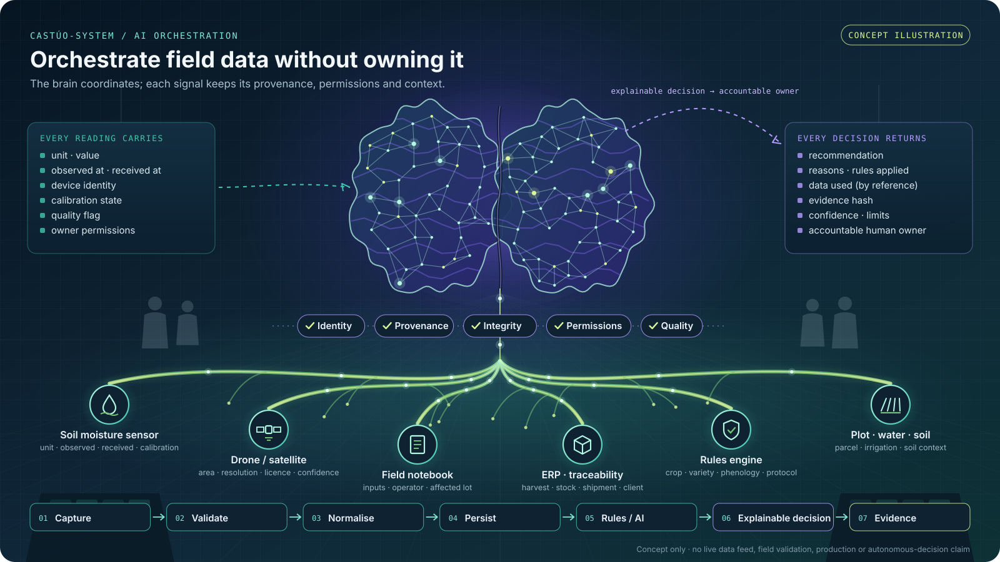

# AI orchestration — coordinate field data without owning it

> **CONCEPT ILLUSTRATION · TARGET ARCHITECTURE · NO PRODUCTION CLAIM**

This public illustration describes a design direction for CASTÚO-SYSTEM: a central digital brain coordinates agricultural data flows **without taking ownership of them**. It integrates, validates and contextualises data, and returns explainable recommendations under explicit governance and data-sovereignty rules. The brain is a coordination layer between sensors, crops, plots, operators and external systems. It is not a commander over a farm, and it is not an autonomous decision engine.

Spanish version of the illustration: [`ai-orchestrator-brain.es.svg`](../assets/diagrams/ai-orchestrator-brain.es.svg).

## Reading the illustration

- **Control room:** dark blue, violet and teal light; side consoles, suspended panels and people in the background stand for operators, agronomists and auditors.
- **Brain:** a neural mesh in two hemispheres. It coordinates; it does not own the data.
- **Roots:** branches that read at once as plant roots, neural links, data flows, irrigation channels and distributed nodes. Intelligence reaches the territory and receives contextualised information from it.
- **Trunk through five controls:** data only reaches the brain after passing **identity, provenance, integrity, permissions and quality** checks.
- **Panels:** what every reading must carry, and what every decision must return to an accountable human owner.

## Governed cycle

`Capture → Validate → Normalise → Persist → Rules / AI → Explainable decision → Evidence`

Each branch is a governed connection, not a free extraction of information:

| Source | Carries |
|---|---|
| Soil moisture sensor | unit, observed time, received time, device, calibration, quality |
| Drone / satellite | area, resolution, source, date, licence, confidence level |
| Field notebook | interventions, inputs, responsible operator, affected lot |
| ERP · traceability | harvest, stock, shipment, client |
| Rules engine | crop, variety, phenological stage, environmental conditions, applicable protocol |
| Plot · water · soil | parcel, irrigation and soil context |

## Questions every datum must answer

Showing values on a dashboard is not enough. Governance by design means each datum can answer verifiable questions:

1. **Who produced it?** Device or operator identity.
2. **When?** Observed time and received time, kept separate.
3. **How?** Method, calibration state and declared quality.
4. **Was it altered?** Integrity hash and provenance chain.
5. **Who may use it, and for what?** Owner permissions and purpose.
6. **Which decision used it?** The recommendation, its reasons, the rules applied and the data referenced.
7. **Who is accountable?** The human owner who accepts or rejects the recommendation.

## Boundaries

This is a static, scalable vector illustration of a target architecture. It is not a live data feed, a deployed orchestrator, a field-validated system, a measured agronomic outcome or an autonomous decision engine. The corresponding engineering, security and operational evidence gates remain open; see [public status](PROFILE-STATUS-DETAIL.md). Related concept: [Governed Flow — evidence sovereignty](GOVERNED-FLOW-SOVEREIGNTY.md).

## Provenance of the asset

- Vector reconstruction drawn from the owner's description of a control-room image; the original raster image is not published here.
- Static SVG with no scripts, no animation, no embedded images and no external fonts.
- SHA-256 (EN): `21f1c18b3eb5eb33c9d3d717d6f0e98b5a5fe1ce6293ad2ca519fb9fed22a771`
- SHA-256 (ES): `8da8e3a442ae534e580fc3a0329321ea9285a37eb5780477f041216a9eb6273f`

---

## Resumen en español

**Ilustración conceptual · arquitectura objetivo · sin claim de producción.** La imagen representa una sala de mando agroindustrial en la que un cerebro digital central **orquesta los flujos de datos agrícolas sin apropiarse de ellos**. Los integra, los valida, los contextualiza y devuelve decisiones explicables bajo reglas de gobernanza y soberanía del dato.

- **Raíces:** ramificaciones que unen el cerebro con sensores, dron o satélite, cuaderno de campo, ERP y trazabilidad, motor de reglas y contexto de parcela. Cada una es una conexión gobernada, no una extracción libre.
- **Cinco controles:** el dato solo llega al cerebro tras superar identidad, procedencia, integridad, permisos y calidad.
- **Ciclo:** `Captura → Validación → Normalización → Persistencia → Reglas/IA → Decisión explicable → Evidencia`.
- **Límites:** es una ilustración estática de una arquitectura objetivo. No es un flujo de datos en vivo, un orquestador desplegado, un sistema validado en campo ni un motor de decisión autónoma. Las compuertas de evidencia siguen abiertas ([estado público](PROFILE-STATUS-DETAIL.es.md)).
